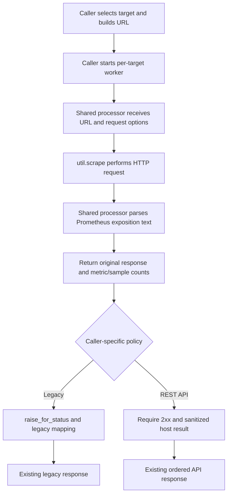

# Business Logic Model — `exporter-scrape-reuse`

## Scope
This unit centralizes the common per-target scrape and Prometheus parsing work. The existing UI view and REST action remain independent orchestration and compatibility boundaries.

## Per-Target Flow

## Responsibilities by Boundary

### Shared processor
Input: caller-constructed URL and request keyword options. It calls existing `util.scrape`, parses `response.text` using `text_string_to_metric_families`, computes metric-family and sample counts, and returns the original response with those counts. It does not classify status codes, build URLs, schedule workers, impose timeouts, or translate exceptions.

### Legacy caller
Retains its login and object permissions, project farm host selection, form defaults, URL formatting, 20-worker pool, executor-level timeout, default scrape options, `raise_for_status()` semantics, legacy exception mapping, and URL-keyed JSON response.

### REST caller
Retains API authentication and saved-exporter permissions, saved/temporary configuration, host validation and limit, IPv6 URL formatting, 20-worker pool, deadline and remaining request timeout, disabled redirects, strict 2xx success rule, sanitized per-host errors, input ordering, aggregate status, and serialized response.

## Data Transformation
The shared processor transforms an HTTP response body into two derived integer counts. It preserves the original response so callers continue to read URL/status details according to their current contracts. A parsing or HTTP execution exception propagates to the caller's existing exception boundary.

## Persistence and Side Effects
No data is persisted or mutated. Each call performs the same outbound HTTP request as before. There is no cross-target shared state; each worker processes one target independently.
