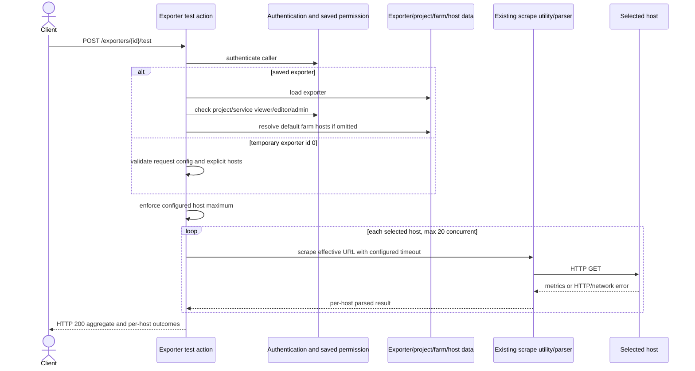

# Business Logic Model — `exporter-test-api`

## Use case

An authenticated Promgen API client requests an exporter test for a persisted exporter or temporary exporter ID `0`. Promgen authorizes the request, resolves an effective exporter configuration and bounded target list, runs the existing scrape/parser flow for each target, and returns an aggregate outcome plus one result per host. The use case is read-only with respect to Promgen persistence.

## Actors and inputs

- **API client**: Authenticated caller that supplies the path exporter ID and optional JSON body.
- **Persisted exporter**: Existing `Exporter` with saved scheme, port, path, and project relationship.
- **Temporary exporter configuration**: Request-scoped scheme, port, and path; `/metrics` is the default path.
- **Targets**: Explicit host names/IPs, or for saved exporters only, all hosts in the associated project farm.
- **Policy/configuration**: Existing project/service permissions, configurable host maximum (default 50), current scrape timeout, and maximum 20 concurrent scrapes.

## Main flow

1. DRF authenticates the caller. Unauthenticated requests stop with the standard REST authentication response.
2. Parse `exporter_id`:
   - `0` selects temporary mode and does not perform an exporter lookup.
   - A positive ID selects saved mode and loads the exporter; a missing ID stops with a not-found response.
   - Other values are rejected as invalid path input.
3. Resolve authorization:
   - Saved mode allows project or service viewer, editor, or admin permissions. The action must not rely on the generic unsafe-method object check, which excludes viewers for POST.
   - Temporary mode requires authentication only and performs no project/service object permission check.
4. Validate mode-specific request data:
   - Saved mode uses persisted scheme, port, and path. Request data cannot override or mutate these fields.
   - Temporary mode requires a non-empty host list, valid `http` or `https` scheme, and a valid port; an omitted path resolves to `/metrics`.
   - Explicit hosts are validated as syntactically acceptable host names/IPs without farm membership checks.
5. Resolve targets:
   - If `hosts` is present, use that list in request order.
   - If it is omitted in saved mode, read all hosts from the exporter's project farm.
   - If a saved exporter's farm has more hosts than the configured maximum, reject before any scrape and ask for an explicit bounded list.
   - If the saved exporter's farm has zero hosts, reject with HTTP 400 and ask for an explicit non-empty host list.
6. Enforce the configured maximum (default 50) before starting outbound work. Over-limit requests return HTTP 400.
7. Build one target URL per selected host using the effective scheme, host, port, and path.
8. Execute scrape requests through the established utility with no more than 20 concurrent workers and the configured scrape timeout. Parse Prometheus exposition data for successful responses.
9. Convert each completion or failure into a result tied to the corresponding selected host. Successful scrape results include HTTP status and metric/sample counts. Failed results include a useful error category/detail. A total execution timeout is represented as failed host results for work that did not complete; completed results retain their outcomes.
10. Set overall `status` to `success` only when every selected host result succeeds; otherwise set it to `failure`.
11. Return HTTP 200 with the structured result once the scrape attempt has run, even if one or all hosts failed.

## Alternate and failure flows

| Condition | Result |
|---|---|
| Invalid exporter ID, malformed body, missing required temporary field, or empty temporary hosts | HTTP 400; no scrape |
| Saved exporter is absent | Existing REST not-found 4xx; no scrape |
| Saved caller lacks project and service viewer/editor/admin role | Standard REST permission response; no scrape |
| Saved exporter has no default farm hosts and caller omitted `hosts` | HTTP 400 asking for an explicit non-empty host list; no scrape |
| Explicit host list exceeds configured maximum | HTTP 400; no scrape |
| Saved farm default host list exceeds configured maximum | HTTP 400 with instruction to provide an explicit list; no scrape |
| Connection error, non-success HTTP status, or invalid exposition | Host result failure; completed operation still HTTP 200 |
| Scrape timeout | Completed operation reports failure for unfinished hosts; HTTP 200 |

## State and side effects

- No database writes, audit mutation, exporter creation, or temporary configuration persistence occurs.
- Outbound requests are the only feature side effect.
- A request rejected before execution does not contact targets.
- A completed run returns one result per selected host, preserving selected-host identity even if an exception lacks a usable response URL.

## Sequence diagram

