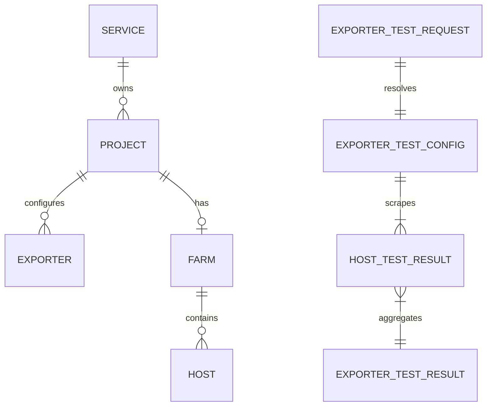

# Domain Entities — `exporter-test-api`

This feature introduces no database entities. The endpoint uses existing persisted entities and request-scoped value objects.

## Existing persisted entities

| Entity | Existing ownership | Use in this feature | Mutation |
|---|---|---|---|
| `Exporter` | Promgen domain model; belongs to `Project` | Supplies saved job settings: scheme, port, and path (empty path resolves to `/metrics`) | Read only |
| `Project` | Promgen domain model; belongs to a `Service` | Resolves the exporter's farm and project-level access scope | Read only |
| `Service` | Promgen domain model | Alternate saved-exporter permission scope | Read only |
| `Farm` | Promgen domain model; associated with a project | Supplies default hosts when saved mode omits `hosts` | Read only |
| `Host` | Promgen domain model; belongs to a farm | Supplies persisted default target names | Read only |
| Authenticated user | Django authentication identity | Identifies caller and permission subject | Read only |

## Request-scoped value objects

### `ExporterTestConfig`

Effective scrape settings resolved for one request:

| Field | Type | Rule |
|---|---|---|
| `scheme` | string | `http` or `https`; persisted for saved mode, supplied for temporary mode |
| `port` | integer | Valid TCP port; persisted for saved mode, supplied for temporary mode |
| `path` | string | Persisted path or `/metrics` fallback; temporary path defaults to `/metrics` |
| `source` | enum | `saved` or `temporary`, useful for validation and tracing without persistence |

### `ExporterTestRequest`

- `hosts`: optional list of host name/IP strings in saved mode; required and non-empty in temporary mode.
- `scheme`, `port`, `path`: accepted for temporary mode. Saved mode does not use them to override persisted attributes.

### `HostTestResult`

Represents exactly one selected target:

| Field | Type | Description |
|---|---|---|
| `host` | string | Selected target identity |
| `status` | enum | `success` or `failure` |
| `status_code` | integer, optional | HTTP response status for a received response |
| `metric_count` | integer, optional | Number of parsed metric families on success |
| `sample_count` | integer, optional | Total parsed samples on success |
| `error` | string, optional | Sanitized scrape, HTTP, timeout, or exposition error detail on failure |

### `ExporterTestResult`

- `status`: `success` only if every `HostTestResult` succeeds; otherwise `failure`.
- `results`: non-empty list of `HostTestResult` values.
- This value is serialized to the REST response and is not stored.

## Relationships

The conceptual request/result types exist only during request processing. `HostTestResult` points to a selected host string, not necessarily a persisted `Host` record, because callers may explicitly test hosts outside the farm.
