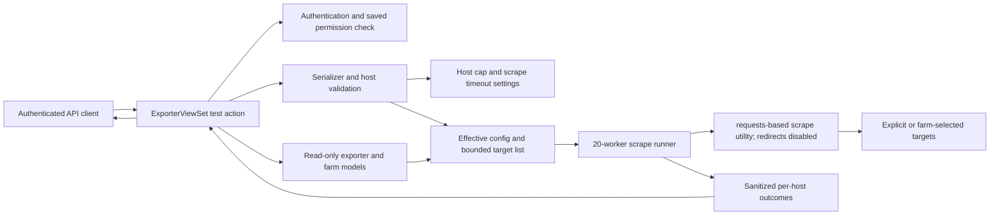

# Logical Components — `exporter-test-api`

## Component inventory

All logical components remain within the existing `promgen` Django application. The NFR design adds behavior to the approved application components; it adds no deployable service or persistence component.

| Component | Existing or planned boundary | NFR responsibility |
|---|---|---|
| Exporter test action | `ExporterViewSet.test` in `promgen/rest_v2.py` | Orchestrate mode selection, saved authorization, validation, target resolution, scrape invocation, and response aggregation. |
| Request validation | Request serializer in `promgen/serializers.py` | Validate temporary config, host syntax, non-empty temporary target selection, and explicit host count before network access. |
| Host policy/configuration | Django settings in `promgen/settings.py` | Provide configurable maximum selected hosts, default 50; retain `PROMGEN_EXPORTER_SCRAPE_TIMEOUT`, default 25 seconds. |
| Saved access check | Existing permission helpers called from the action | Enforce project/service viewer, editor, or admin access for persisted exporters; do not perform an object permission check for ID `0`. |
| Saved target resolver | Existing `Exporter`, `Project`, `Farm`, and `Host` models | Read saved exporter configuration and farm defaults. Reject empty or oversized implicit target sets. Perform no writes. |
| Scrape runner | Existing scrape utility/parser and bounded executor | Issue requests with redirects disabled and configured timeout, up to 20 workers, parse metrics, and isolate per-host outcomes. |
| Result sanitizer/aggregator | Response-building logic within the API action | Sanitize failure detail, produce one result per selected host, and mark overall success only when all hosts succeed. |
| API schema | Existing `drf-spectacular` annotations | Document request modes, limits, authorization, redirect behavior, and HTTP 200 completion semantics. |

## Request flow and trust boundaries

## Operational sequence

1. DRF authenticates the caller.
2. The action distinguishes saved IDs from reserved ID `0`; saved mode applies the explicit viewer/editor/admin permission check.
3. The serializer validates mode-specific fields and host syntax. The action resolves defaults, rejects empty or over-limit selections, and constructs authority-safe target URLs before submitting tasks.
4. The scrape runner submits no more than the selected host count to a maximum of 20 workers. Each HTTP request receives the existing configured timeout and disables redirects.
5. Each completion or failure is converted to one sanitized `HostTestResult`; completed outcomes are retained when another target fails or times out.
6. The response builder derives aggregate status from all host results and returns HTTP 200 once scrape execution and result assembly complete.

## Configuration and resource bounds

- `PROMGEN_EXPORTER_TEST_MAX_HOSTS`: planned configurable setting, default 50.
- `PROMGEN_EXPORTER_SCRAPE_TIMEOUT`: existing configured setting, default 25 seconds.
- Scrape worker count: fixed maximum 20, matching existing behavior.
- No additional endpoint-level rate limiter, job queue, cache, database entity, or telemetry backend.

## Failure containment

- Invalid request, missing exporter, failed authorization, empty implicit farm, or exceeded target cap fails before any outbound task is created.
- A target timeout, network error, 3xx/other unacceptable HTTP response, or exposition parse error affects only that host result where execution permits; other results remain available.
- Sanitization occurs before error values enter the response. No feature-specific result or host data is written to the database or a new log stream.
