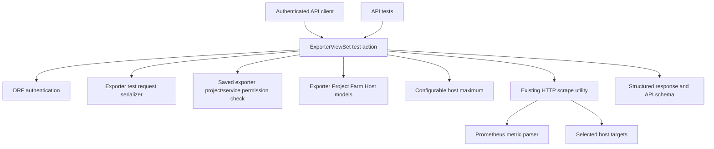

# Component Dependencies — PROMGENDEV-275

## Dependency Diagram

## Dependency Matrix

| Consumer | Provider | Dependency | Direction / Pattern |
|---|---|---|---|
| Exporter test action | DRF authentication | Authenticated request identity | Synchronous framework call |
| Exporter test action | Request serializer | Validated mode-specific inputs | Synchronous function call |
| Exporter test action | Permission helper | Saved exporter project/service authorization | Synchronous function call; skipped for temporary ID `0` |
| Exporter test action | ORM models | Saved exporter and default farm hosts | Synchronous database reads |
| Request validation | Application settings | Configurable host maximum | In-process configuration read |
| Exporter test action | Existing scrape utility | Per-host HTTP scrape | Synchronous orchestration with bounded concurrency |
| Scrape utility | Prometheus parser | Metric family/sample extraction | In-process function call |
| Exporter test action | DRF response/schema tooling | Aggregate result payload and OpenAPI description | Synchronous response generation |
| API tests | Exporter test action | Endpoint behavior verification | Django/DRF test client |

## Data Flow

1. DRF authenticates the API client.
2. The test action resolves the saved exporter or recognizes ID `0`.
3. Saved mode loads saved attributes and checks project/service access. Temporary mode validates request-supplied scrape settings and requires hosts.
4. The action validates host selection against the configured maximum. If hosts are omitted in saved mode, it obtains all hosts from the exporter's project farm and rejects an oversized default set.
5. The scrape utility contacts each target using existing concurrency and timeout settings and parses Prometheus metrics.
6. The action creates one result per host and aggregate success only when all results succeed.
7. The API returns HTTP 200 after a test runs; pre-execution failures use 4xx responses.

## Dependency Constraints
- The test action must not update the `Exporter` model.
- The temporary mode must not require project/service object authorization, but it must remain authenticated.
- Persisted mode must support viewer access for this test operation even though general unsafe exporter updates require elevated roles.
- Host membership is not restricted to a farm; the approved API policy permits private and loopback targets.
- No dependency on a new database schema, message queue, or infrastructure component is introduced.
