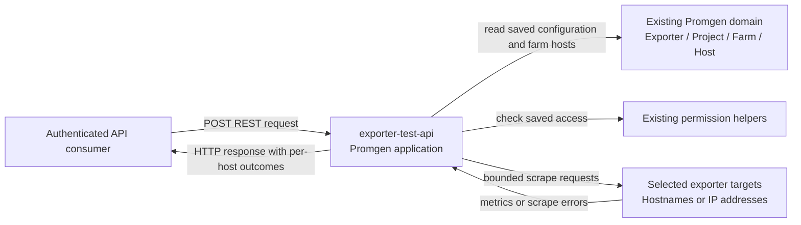

# Context Map — PROMGENDEV-275

## Unit boundaries and relationships

## Data ownership

- **`exporter-test-api`** owns endpoint orchestration, request/response semantics, and feature-specific tests. It owns no persisted domain data; temporary inputs and results are request-scoped.
- **Existing Promgen domain models** own persisted exporter, project, farm, and host data. The feature reads this data and does not modify it.
- **Existing permission helpers, scrape utilities, parser, and application settings** remain shared capabilities owned by the existing application. The unit consumes them.
- **API caller** owns the request and chooses optional test targets. The endpoint does not claim ownership of target systems.
- **Selected targets** are external systems contacted during a test; they return scrape content or errors and are not Units of Work in this change.

## Relationship matrix

| Upstream | Downstream | Direction | Pattern / relationship |
|---|---|---|---|
| Authenticated API consumer | `exporter-test-api` | Request to unit; response back to caller | Open Host Service through the REST endpoint; the API contract is the published language |
| Existing Promgen domain models | `exporter-test-api` | Unit reads domain data | Conformist use of the existing application's model and ownership boundaries; no data transfer of ownership |
| Existing permission and scrape capabilities | `exporter-test-api` | Unit invokes shared application functions | In-process integration; no independent unit boundary |
| `exporter-test-api` | Selected exporter targets | Outbound scrape request; results return to unit | External HTTP interaction; targets are not owned units |

There are no relationships between independent Units of Work because the approved decomposition contains one unit. No Shared Kernel or inter-unit contract is introduced.

## Text alternative

There is one Unit of Work, `exporter-test-api`, which owns the new REST operation's coordination and response behavior. It reads saved exporter and farm data from existing Promgen models, uses existing permission and scrape capabilities, calls selected external hosts, and returns structured results to the authenticated API caller. Persisted domain data remains owned by the existing models. Neither callers nor target systems are units in this decomposition.

## Verification checklist

- [x] All Units of Work are included in the map.
- [x] Data ownership is explicit and no persisted data is CRUDed by multiple units.
- [x] There are no circular dependencies; there is only one unit, and all other relationships are directed dependencies or external interactions.
- [x] Unit granularity is appropriate for one endpoint and one story within a brownfield application; no independent deployable or separately owned module is warranted.
