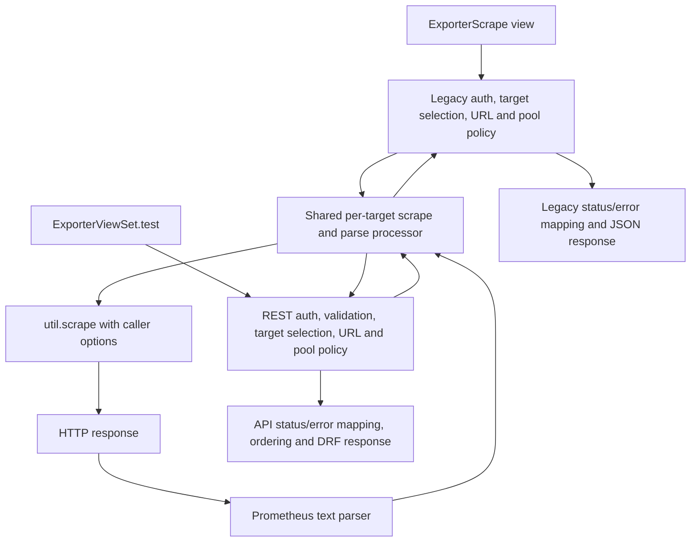

# Component Dependencies — `exporter-scrape-reuse`

## Dependency Matrix

| Component | Depends on | Communication |
|---|---|---|
| `ExporterScrape` view | Existing Django auth/permissions, project/farm/host models, settings, thread pool, shared processor | Synchronous orchestration; submits per-host worker calls to its executor |
| `ExporterViewSet.test` action | Existing DRF auth/permissions/serializers, exporter/project/farm/host models, settings, thread pool, shared processor | Synchronous orchestration; submits per-host worker calls to its executor |
| Shared scrape processor | `promgen.util.scrape`, Prometheus text parser | Direct function calls; returns response and metric/sample counts; exceptions propagate |
| `promgen.util.scrape` | Existing HTTP client implementation | HTTP request using caller-provided options |
| Prometheus parser | Prometheus exposition response text | In-process parse |

## Data Flow

## Dependency Rules
- Both entry points depend on the shared processor; neither contains a duplicate metric parsing/counting implementation after the refactor.
- The shared processor depends only on existing scrape and parsing facilities and has no dependency on Django views, DRF, models, authorization, response serializers, or endpoint settings.
- The shared processor returns the original response so each caller can apply its own status and URL-specific behavior.
- No cross-call from the API action to the legacy view or vice versa is introduced.

## Consistency Review
- FR-1 and FR-5: both callers use the same request-and-parse processor.
- FR-2 and FR-3: endpoint-specific selection, authorization, timeout, redirect, status, error, ordering, and serialization behavior remains at each entry point.
- FR-4: request options and response policies are caller-owned.
- NFR-2 and NFR-3: concurrency/timeout and `util.scrape` defaults are preserved per caller.
- No new public endpoint, dependency, persistence, migration, or infrastructure component is designed.
