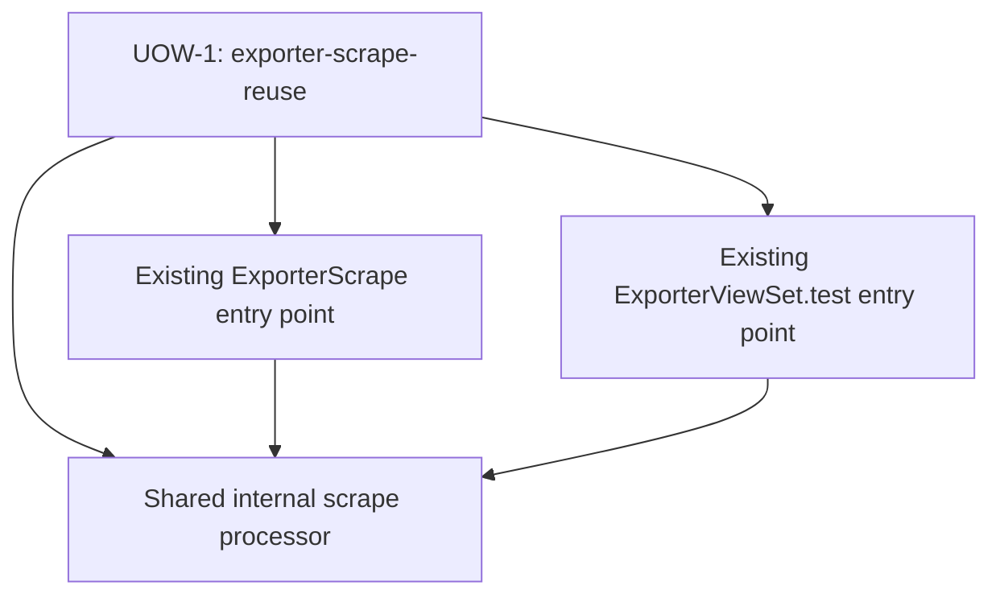

# Context Map — `exporter-scrape-reuse`

## Unit and Ownership
- **UOW-1 `exporter-scrape-reuse`** owns the implementation change for the shared internal scrape processor and its integrations with both existing entry points. This is a code-change boundary, not a new domain or data-owning service.
- Existing exporter, project, farm, and host data remain owned by the existing Promgen models and are not reassigned or mutated by this unit.

## Relationships
There is one unit, so there are no inter-unit upstream/downstream relationships and no cross-unit communication. Within UOW-1, both callers synchronously invoke the shared processor from their existing per-target workers. The relationship is direct in-process function use, not a separately deployed service or bounded context.

## Verification
- [x] The sole unit is included.
- [x] Existing model data ownership remains with existing Promgen models.
- [x] No inter-unit dependency or circular dependency exists.
- [x] One unit is appropriate because helper and both integrations are only complete together.
