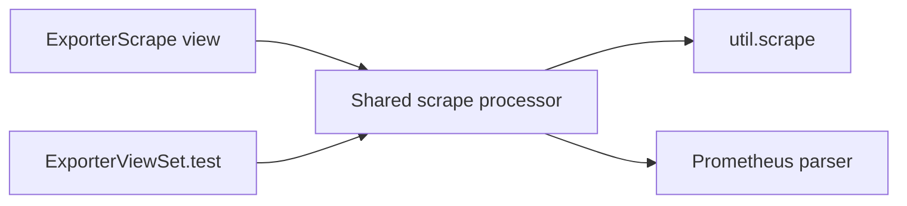

# Unit of Work Dependencies — `exporter-scrape-reuse`

## Dependency Matrix

| Unit | Depends on | Relationship | Build order |
|---|---|---|---|
| UOW-1 `exporter-scrape-reuse` | Existing `util.scrape`, Prometheus parser, Django application, and endpoint implementations | Uses existing in-process utilities; adapts two existing callers to a shared internal function | Single unit; implement shared processor and both integrations together, then verify regression coverage |

There are no dependencies between newly defined units because the scope is intentionally one cohesive unit.

## Internal Implementation Sequence
1. Define the shared processor result and request-options pass-through.
2. Implement the processor over existing HTTP scrape and Prometheus parser utilities.
3. Adapt both endpoint workers while retaining their local policy boundaries.
4. Add focused helper and endpoint regression coverage.
5. Review behavior-preservation criteria and run the approved verification plan during Construction Build and Test.

## Dependency Direction
Both entry points depend on the shared processor. The shared processor depends on existing low-level scrape and parsing utilities. It must not depend on either entry point, Django response construction, serializers, authorization, or models.

