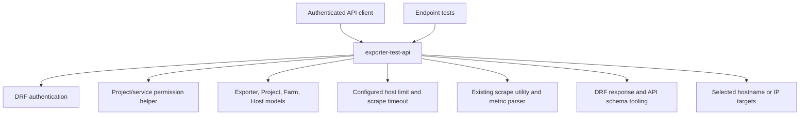

# Unit of Work Dependencies — PROMGENDEV-275

## Dependency diagram

## Unit dependency matrix

| Consumer | Provider | Data or capability | Direction / pattern |
|---|---|---|---|
| `exporter-test-api` | DRF authentication | Authenticated caller identity | In-process framework call |
| `exporter-test-api` | Permission helper | Saved exporter project/service authorization | In-process call; temporary ID `0` skips object permission |
| `exporter-test-api` | Existing ORM models | Saved exporter configuration and default farm hosts | Read-only database access |
| `exporter-test-api` | Application settings | Maximum host count and scrape timeout | In-process configuration read |
| `exporter-test-api` | Scrape utility and parser | Bounded host scraping and metric extraction | In-process orchestration and outbound HTTP |
| `exporter-test-api` | DRF response/schema tooling | Result response and endpoint documentation | In-process framework integration |
| Endpoint tests | `exporter-test-api` | Observable endpoint behavior | Django/DRF test client |

## Constraints

- There is one Unit of Work, so no dependency between separately owned units exists.
- Saved exporter and related domain data are read but not modified by the test operation.
- Temporary settings and results have request scope and are not persisted.
- Existing scrape concurrency and timeout bounds remain in force.
- Host destinations may be outside the exporter's farm, including private and loopback addresses, according to the approved requirements.
