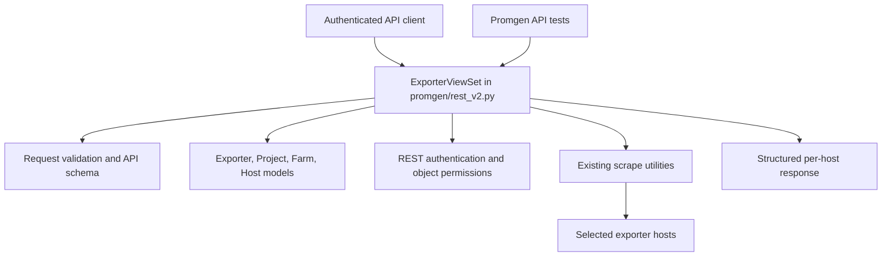

# Execution Plan — PROMGENDEV-275

## Detailed Analysis Summary

### Transformation Scope
- **Transformation Type**: Single application component/API extension.
- **Primary Changes**: Add an exporter test action to the existing v2 API, request validation and host selection, per-host result reporting, and API schema description.
- **Related Components**: `promgen/rest_v2.py`, serializers/request validation, existing scrape utilities, `promgen/settings.py` for the configurable host limit, API schema annotations, and tests.
- **Data Model**: No model or database schema change is currently required.
- **Infrastructure**: No deployment or infrastructure-as-code change is identified.

### Change Impact Assessment
- **User-facing changes**: Yes — new API operation for Promgen API consumers.
- **Structural changes**: No — remains within the existing Django application and v2 API.
- **Data model changes**: No — saved exporters and farms are read; temporary exporter settings are not persisted.
- **API changes**: Yes — new POST endpoint and response contract.
- **NFR impact**: Yes — bounded host fan-out, scrape timeout/concurrency, authentication, and outbound target policy.

### Component Relationships (Brownfield)

### Component Relationships — Text Alternative
- **Primary Component**: Promgen v2 `ExporterViewSet` and its exporter-test action.
- **Infrastructure Components**: None identified.
- **Shared Components**: Existing serializers, permission helpers, settings, scrape utilities, and response/schema tooling within `promgen`.
- **Dependent Components**: API clients consume the endpoint and response. The endpoint reads saved exporter/project/farm/host data and makes outbound HTTP requests to selected targets.
- **Supporting Components**: API tests verify permissions, request validation, host bounds, saved configuration integrity, and per-host outcomes.
- **Change Type**: Minor, backward-compatible API addition; no existing API route is removed.
- **Change Priority**: Endpoint contract, authorization, and bounded outbound work are required. Infrastructure changes are not currently needed.

### Risk Assessment
- **Risk Level**: High.
- **Rollback Complexity**: Easy to moderate; no data migration is expected, though API clients may begin using the new endpoint.
- **Testing Complexity**: Moderate.
- **Risk Factors**: Temporary exporter requests do not perform project/service object-level authorization and may target private or loopback addresses. The API still requires authentication. The NFR stages should define how authentication, host limits, existing timeout/concurrency protections, and outbound target behavior are implemented and verified.

## Workflow Visualization

```mermaid
flowchart TD
  Start([Start]) --> WD[Workspace Detection]
  WD --> RE[Reverse Engineering]
  RE --> RA[Requirements Analysis]
  RA --> US[User Stories]
  US --> WP[Workflow Planning]
  WP --> AD[Application Design]
  AD --> UG[Units Generation]
  UG --> FD[Functional Design]
  FD --> NR[NFR Requirements]
  NR --> ND[NFR Design]
  ND --> ID[Infrastructure Design]
  ID --> CP[Code Planning]
  CP --> CG[Code Generation]
  CG --> BT[Build and Test]
  BT --> End([Ready for construction completion])

  subgraph IN[INCEPTION]
    WD
    RE
    RA
    US
    WP
    AD
    UG
  end
  subgraph CO[CONSTRUCTION]
    FD
    NR
    ND
    ID
    CP
    CG
    BT
  end

  style WD fill:#4CAF50,stroke:#1B5E20,stroke-width:3px,color:#fff
  style RE fill:#4CAF50,stroke:#1B5E20,stroke-width:3px,color:#fff
  style RA fill:#4CAF50,stroke:#1B5E20,stroke-width:3px,color:#fff
  style US fill:#4CAF50,stroke:#1B5E20,stroke-width:3px,color:#fff
  style WP fill:#FFA726,stroke:#E65100,stroke-width:3px,stroke-dasharray:5 5,color:#000
  style AD fill:#FFA726,stroke:#E65100,stroke-width:3px,stroke-dasharray:5 5,color:#000
  style UG fill:#FFA726,stroke:#E65100,stroke-width:3px,stroke-dasharray:5 5,color:#000
  style FD fill:#FFA726,stroke:#E65100,stroke-width:3px,stroke-dasharray:5 5,color:#000
  style NR fill:#FFA726,stroke:#E65100,stroke-width:3px,stroke-dasharray:5 5,color:#000
  style ND fill:#FFA726,stroke:#E65100,stroke-width:3px,stroke-dasharray:5 5,color:#000
  style ID fill:#BDBDBD,stroke:#424242,stroke-width:2px,stroke-dasharray:5 5,color:#000
  style CP fill:#4CAF50,stroke:#1B5E20,stroke-width:3px,color:#fff
  style CG fill:#4CAF50,stroke:#1B5E20,stroke-width:3px,color:#fff
  style BT fill:#4CAF50,stroke:#1B5E20,stroke-width:3px,color:#fff
  style Start fill:#CE93D8,stroke:#6A1B9A,stroke-width:3px,color:#000
  style End fill:#CE93D8,stroke:#6A1B9A,stroke-width:3px,color:#000
  style IN fill:#BBDEFB,stroke:#1565C0,stroke-width:2px,color:#000
  style CO fill:#C8E6C9,stroke:#2E7D32,stroke-width:2px,color:#000
  linkStyle default stroke:#333,stroke-width:2px
```

### Workflow Visualization — Text Alternative

- **INCEPTION**: Workspace Detection (completed) → Reverse Engineering (completed) → Requirements Analysis (completed) → User Stories (completed) → Workflow Planning (in progress) → Application Design (execute) → Units Generation (execute).
- **CONSTRUCTION**: Functional Design (execute) → NFR Requirements (execute) → NFR Design (execute) → Infrastructure Design (skip) → Code Planning (execute) → Code Generation (execute) → Build and Test (execute).

## Phases to Execute

### 🔵 INCEPTION PHASE
- [x] Workspace Detection (COMPLETED)
- [x] Reverse Engineering (COMPLETED)
- [x] Requirements Analysis (COMPLETED)
- [x] User Stories (COMPLETED)
- [x] Workflow Planning (IN PROGRESS)
- [ ] Application Design — EXECUTE
  - **Rationale**: Define the new endpoint's component responsibilities, request/result interfaces, and interaction with existing permission and scrape components.
- [ ] Units Planning — EXECUTE
  - **Rationale**: Define one logical implementation unit and map its dependencies and story coverage.
- [ ] Units Generation — EXECUTE
  - **Rationale**: The approved story represents a new API operation with multiple behavioral scenarios; generate its unit definition, dependency mapping, context map, and interface contract.

### 🟢 CONSTRUCTION PHASE
- [ ] Functional Design — EXECUTE
  - **Rationale**: Define detailed behavior for saved and temporary exporter modes, host selection, validations, status codes, and aggregate results.
- [ ] NFR Requirements — EXECUTE
  - **Rationale**: Bound outbound work and define security, authentication, timeout, and concurrency expectations for an API that accepts private and loopback targets.
- [ ] NFR Design — EXECUTE
  - **Rationale**: Design controls and verification for the approved host policy and request limits while retaining the existing scrape protections.
- [ ] Infrastructure Design — SKIP
  - **Rationale**: No infrastructure or deployment change is currently indicated.
- [ ] Code Planning — EXECUTE (ALWAYS)
  - **Rationale**: An implementation approach is needed for the endpoint and request/result contract.
- [ ] Code Generation — EXECUTE (ALWAYS)
  - **Rationale**: The API feature requires application code changes.
- [ ] Build and Test — EXECUTE (ALWAYS)
  - **Rationale**: Verify the endpoint, permissions, validation, scrape outcomes, and regression behavior.

### 🟡 OPERATIONS PHASE
- [ ] Operations — PLACEHOLDER
  - **Rationale**: Future deployment and monitoring workflow; not part of the requested feature scope.

## Package Change Sequence (Brownfield)
1. **`promgen` API and supporting code** — Add the v2 action, request validation, configurable host cap, response handling, and schema documentation within the existing application.
2. **`promgen/tests`** — Add API coverage for saved and temporary modes, permissions, host selection and limits, failure results, and non-mutation.

There is one application package, so no cross-package parallelization or release coordination is required.

## Estimated Timeline
- **Total implementation stages to execute**: 6 (Functional Design, NFR Requirements, NFR Design, Code Planning, Code Generation, Build and Test); Infrastructure Design is skipped.
- **Estimated Duration**: Not specified in the Jira request; estimate during construction planning.

## Success Criteria
- **Primary Goal**: An authenticated API consumer can test a saved or temporary exporter and understand per-host scrape outcomes.
- **Key Deliverables**: Approved design and unit artifacts; v2 endpoint; request/response schema documentation; tests covering the approved acceptance criteria.
- **Quality Gates**: Saved exporter configuration remains unchanged; host cap and authorization are enforced as specified; executed tests return structured outcomes with HTTP 200 even when scrapes fail; validation and access failures return suitable 4xx responses.
- **Integration Testing**: API behavior works with the existing models, permission helpers, scrape utilities, and REST conventions.
- **Operational Readiness**: Existing timeout/concurrency protections are retained; no new infrastructure or monitoring setup is required by current scope.
