# Execution Plan — `exporter-scrape-reuse`

## Detailed Analysis Summary

### Transformation Scope
- **Transformation Type**: Application-level refactor across two existing Django entry points.
- **Primary Changes**: Extract common scrape execution and metric parsing into an internal shared component; adapt `ExporterScrape` and the v2 exporter test action to use it.
- **Related Components**: `promgen/views.py`, `promgen/rest_v2.py`, shared scrape logic, and tests in `promgen/tests/`.

### Change Impact Assessment
- **User-facing changes**: No intended behavior or output changes.
- **Structural changes**: Yes; common internal implementation is introduced or relocated.
- **Data model changes**: No.
- **API changes**: No; both existing endpoint contracts remain fixed.
- **NFR impact**: No new NFRs; preserve concurrency, timeout, redirect, authentication, and sanitization behavior as each caller currently defines it.

### Component Relationships
- **Primary Components**: Legacy `ExporterScrape` view and v2 `ExporterViewSet.test` action.
- **Shared Component**: Internal scrape/parse execution helper, called by both entry points.
- **Dependencies**: Existing `promgen.util.scrape`, Prometheus exposition parser, existing settings, and Django/DRF.
- **Infrastructure**: None.

### Risk Assessment
- **Risk Level**: Medium; shared execution affects both UI and API paths with intentionally different contracts.
- **Rollback Complexity**: Easy; isolated source changes, no data migration.
- **Testing Complexity**: Moderate; verify the shared component and regression behavior for both endpoints.

## Workflow Visualization

```mermaid
flowchart TD
  Start([Start]) --> WD[Workspace Detection: complete]
  WD --> RE[Focused Reverse Engineering: complete]
  RE --> RA[Requirements Analysis: complete]
  RA --> US[User Stories: skip]
  US --> WP[Workflow Planning: review]
  WP --> AD[Application Design: execute]
  AD --> UP[Units Planning: execute]
  UP --> UG[Units Generation: execute]
  UG --> FD[Functional Design: execute]
  FD --> NR[NFR Requirements: skip]
  NR --> ND[NFR Design: skip]
  ND --> ID[Infrastructure Design: skip]
  ID --> CP[Code Planning: execute]
  CP --> CG[Code Generation: execute]
  CG --> BT[Build and Test: execute]
  BT --> End([End; operations planning is separate])
  style Start fill:#CE93D8,stroke:#6A1B9A,stroke-width:3px,color:#000
  style End fill:#CE93D8,stroke:#6A1B9A,stroke-width:3px,color:#000
  style WD fill:#4CAF50,stroke:#1B5E20,stroke-width:3px,color:#fff
  style RE fill:#4CAF50,stroke:#1B5E20,stroke-width:3px,color:#fff
  style RA fill:#4CAF50,stroke:#1B5E20,stroke-width:3px,color:#fff
  style US fill:#BDBDBD,stroke:#424242,stroke-width:2px,stroke-dasharray:5 5,color:#000
  style WP fill:#FFA726,stroke:#E65100,stroke-width:3px,stroke-dasharray:5 5,color:#000
  style AD fill:#FFA726,stroke:#E65100,stroke-width:3px,stroke-dasharray:5 5,color:#000
  style UP fill:#FFA726,stroke:#E65100,stroke-width:3px,stroke-dasharray:5 5,color:#000
  style UG fill:#FFA726,stroke:#E65100,stroke-width:3px,stroke-dasharray:5 5,color:#000
  style FD fill:#FFA726,stroke:#E65100,stroke-width:3px,stroke-dasharray:5 5,color:#000
  style NR fill:#BDBDBD,stroke:#424242,stroke-width:2px,stroke-dasharray:5 5,color:#000
  style ND fill:#BDBDBD,stroke:#424242,stroke-width:2px,stroke-dasharray:5 5,color:#000
  style ID fill:#BDBDBD,stroke:#424242,stroke-width:2px,stroke-dasharray:5 5,color:#000
  style CP fill:#FFA726,stroke:#E65100,stroke-width:3px,stroke-dasharray:5 5,color:#000
  style CG fill:#FFA726,stroke:#E65100,stroke-width:3px,stroke-dasharray:5 5,color:#000
  style BT fill:#FFA726,stroke:#E65100,stroke-width:3px,stroke-dasharray:5 5,color:#000
```

## Phases to Execute

### Inception
- **Workspace Detection**: Complete; reuse the current brownfield workspace/session.
- **Reverse Engineering**: Complete; focused overlap analysis recorded.
- **Requirements Analysis**: Complete; behavior preservation is required.
- **User Stories**: Skip. The refactor has no intended user-visible behavior change.
- **Workflow Planning**: Approved on 2026-10-21.
- **Application Design**: Execute. Define the shared component boundary and caller-specific adapters/options.
- **Units Planning and Generation**: Execute. Keep one bounded unit for the shared helper and both integrations, with their regression tests.

### Construction
- **Functional Design**: Execute (required per unit); describe unchanged entry-point behavior and shared internal responsibility.
- **NFR Requirements**: Skip; no new quality attribute requirement is introduced.
- **NFR Design**: Skip; preserve existing patterns and bounds.
- **Infrastructure Design**: Skip; no deployment or infrastructure changes.
- **Code Planning**: Execute.
- **Code Generation**: Execute.
- **Build and Test**: Execute. Run focused view/API regression tests and the repository checks; report known baseline failures separately.

### Operations
- No deployment or operations change is part of this refactor.

## Package Change Sequence
1. Add/identify the internal shared scrape component in the `promgen` application.
2. Adapt the legacy view and v2 action to delegate to it while preserving their policies and response adapters.
3. Add or adjust shared and entry-point regression tests.

## Estimated Timeline
- One application unit; detailed effort estimate is deferred to Code Planning.

## Success Criteria
- Both entry points use shared scrape execution and metric parsing.
- Their existing external contracts and endpoint-specific policies remain unchanged.
- Focused regression tests cover the helper and both callers.
- No migrations, dependencies, infrastructure changes, or unrelated scope are introduced.
