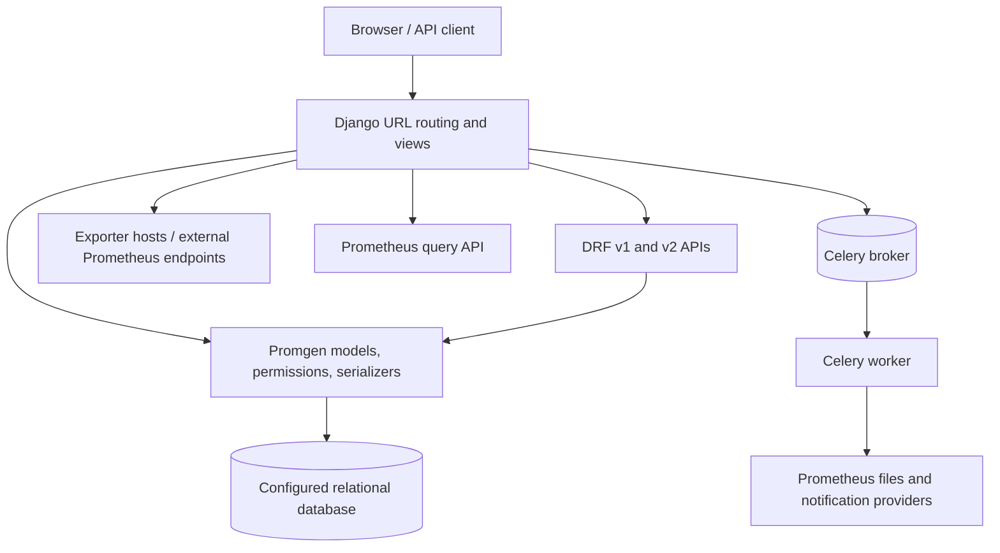
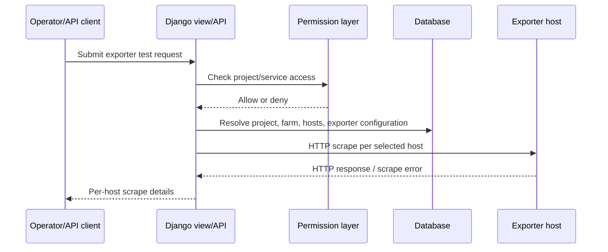

# System Architecture

## System Overview
Promgen is a Python/Django web application. Django views and Django REST Framework viewsets expose the UI and APIs; ORM models persist monitoring entities. The application generates Prometheus configuration and performs outbound scrape/query requests. Celery supports asynchronous work and notification/configuration tasks.

## Architecture Diagram

## Component Descriptions
### `promgen` Django application
- **Purpose**: Central web application and domain model.
- **Responsibilities**: UI, API, persistence, permissions, config rendering and integrations.
- **Dependencies**: Django, DRF, django-filter, django-guardian, Celery, requests, prometheus-client.
- **Type**: Application.
### `promgen/tests`
- **Purpose**: Unit and integration-level application tests.
- **Responsibilities**: Verify models, views, routes, API behavior, renderers, and notifications.
- **Dependencies**: Django test framework and project dependencies.
- **Type**: Test.
### Docker/deployment configuration
- **Purpose**: Build and run web and worker processes.
- **Responsibilities**: Container packaging and local stack configuration.
- **Type**: Infrastructure/Operations.

## Data Flow

## Integration Points
- **External APIs**: Prometheus query endpoints; HTTP exporter scrape endpoints; configured notification providers.
- **Databases**: Django-configured relational database for application data.
- **Third-party Services**: Celery broker and configured discovery/notification plugins.

## Infrastructure Components
- **CDK/Terraform**: None found in the repository scan.
- **Deployment Model**: Docker image; compose configuration; separate web and Celery worker processes.
- **Networking**: Web process reaches configured exporter hosts and Prometheus; deployment networking is environment-configured.
