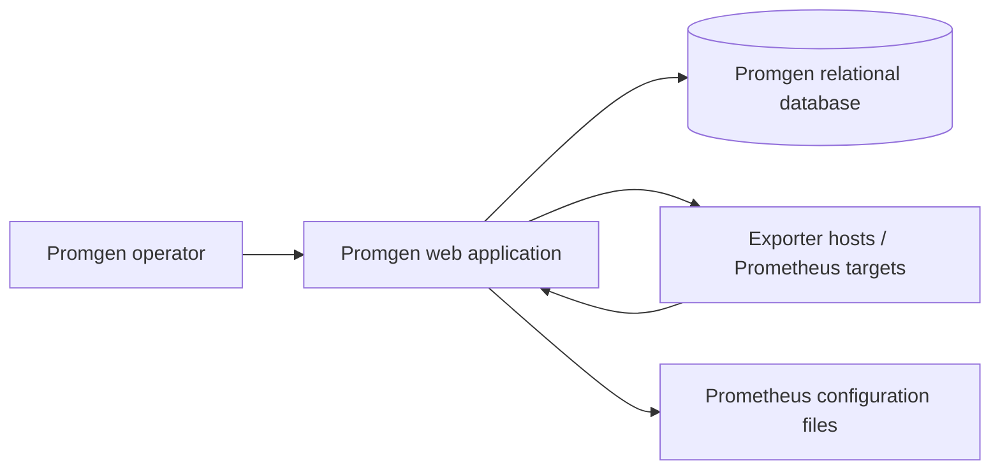

# Business Overview

## Business Context Diagram

## Business Description
- **Business Description**: Promgen manages Prometheus monitoring configuration, including services, projects, target farms, exporters, alert rules, and notification integrations.
- **Business Transactions**: Manage monitoring entities and permissions; generate Prometheus configuration; inspect/test exporter scrapes; receive alerts and route notifications.
- **Business Dictionary**: A **Service** groups monitored projects; a **Project** is a monitoring configuration scope; a **Farm** groups **Hosts**; an **Exporter** defines job, port, path, and scheme for a scrape target.

## Component Level Business Descriptions
### Django application (`promgen/`)
- **Purpose**: Manage Prometheus monitoring configuration and expose UI and API workflows.
- **Responsibilities**: Domain models, permission checks, REST endpoints, configuration rendering, scrape and query integrations, notifications.
### Tests (`promgen/tests/`)
- **Purpose**: Verify application behavior and API/UI contracts.
- **Responsibilities**: Django test cases, REST CSV-driven cases, fixtures, route checks.
### Operations (`docker/`, `Dockerfile`, `docker-compose.yml`)
- **Purpose**: Package and run web and worker services with supporting infrastructure.
- **Responsibilities**: Container image and demo/development deployment configuration.
