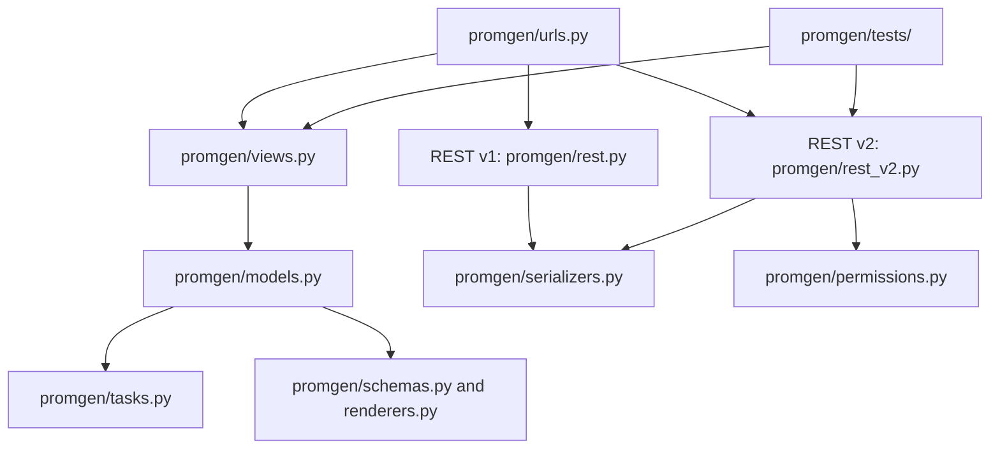

# Code Structure

## Build System
- **Type**: Python setuptools (`pyproject.toml`); Docker/Make for packaging and operations.
- **Configuration**: `pyproject.toml`, `Makefile`, `Dockerfile`, `docker-compose.yml`.

## Key Classes/Modules

### Existing Files Inventory (feature-relevant)
- `promgen/views.py` - UI views; `ExporterScrape` implements the current scrape test.
- `promgen/urls.py` - UI, v1 and v2 route registration.
- `promgen/rest_v2.py` - DRF v2 endpoints; `ExporterViewSet` exposes exporter CRUD/read operations.
- `promgen/serializers.py` - DRF serialization and validation.
- `promgen/models.py` - Service, Project, Farm, Host, Exporter and related ORM entities.
- `promgen/permissions.py` - Object permission mapping and reusable REST permission classes.
- `promgen/prometheus.py` - Prometheus scrape/query helpers.
- `promgen/tests/test_routes.py` - Existing scrape route test.
- `promgen/tests/test_rest.py`, `promgen/tests/cases/` - REST API coverage and request cases.

## Design Patterns
### Django class-based views and DRF viewsets
- **Location**: `promgen/views.py`, `promgen/rest_v2.py`.
- **Purpose**: Separate URL dispatch from domain operations and API behavior.
- **Implementation**: Django `View`/generic views and DRF generic viewsets with serializers and permission classes.
### Plugin entry points
- **Location**: `pyproject.toml`, `promgen/plugins.py`, discovery and notification modules.
- **Purpose**: Allow configurable discovery and notification integrations.
- **Implementation**: Python package entry points.

## Critical Dependencies
### Django / Django REST Framework
- **Version**: Django 4.2.26 pinned; DRF declared without a pin.
- **Usage**: Web framework, ORM, routing, and REST APIs.
- **Purpose**: Core application platform.
### requests / prometheus-client
- **Version**: Unpinned in `pyproject.toml`.
- **Usage**: HTTP requests and exposition-format metric parsing.
- **Purpose**: Scrape and interpret exporter responses.
