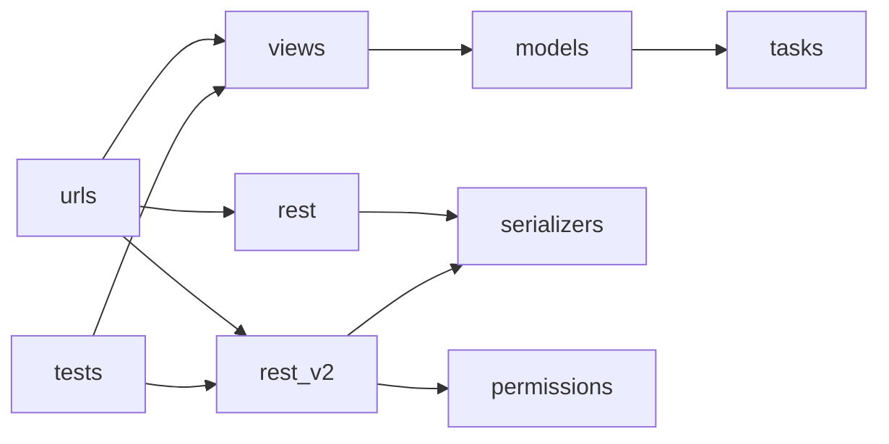

# Dependencies

## Internal Dependencies

### `promgen` modules depend on one another
- **Type**: Runtime.
- **Reason**: Views, APIs, models, serializers, permission checks, task processing, and config rendering form one Django application.

## External Dependencies
### Django / Django REST Framework
- **Version**: Django==4.2.26; DRF unpinned.
- **Purpose**: Web and API platform.
- **License**: Upstream licenses; not assessed individually.
### Celery / Kombu
- **Version**: Unpinned.
- **Purpose**: Background task queue and messaging.
- **License**: Upstream licenses; not assessed individually.
### Requests / prometheus-client
- **Version**: Unpinned.
- **Purpose**: HTTP and Prometheus metric processing.
- **License**: Upstream licenses; not assessed individually.
### django-guardian / django-filter / drf-spectacular
- **Version**: Unpinned.
- **Purpose**: Object permissions, API filtering, and API schema generation.
- **License**: Upstream licenses; not assessed individually.
