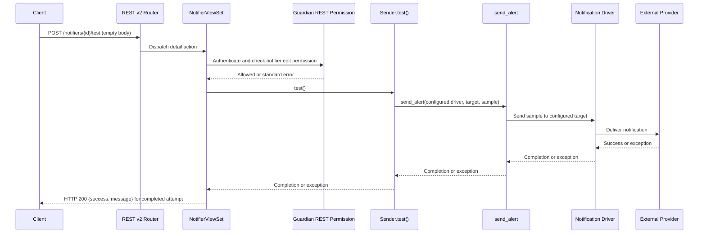

# Component Dependencies — Test a Notifier

## Dependency Matrix
| Caller | Callee | Dependency | Pattern |
|---|---|---|---|
| REST router | `NotifierViewSet` | Resolves `/rest/v2/notifiers/{id}/test` to a detail action | HTTP/DRF routing |
| `NotifierViewSet` | `PromgenGuardianRestPermission` | Authentication and edit-level object authorization | DRF permission hook |
| `NotifierViewSet` | `Sender` | Loads selected notifier and calls `test()` | Direct in-process method call |
| `Sender.test()` | `promgen.tasks.send_alert` | Sends existing sample data using configured driver and target | Synchronous direct task call |
| `send_alert` | Notification plugin/driver | Performs provider delivery | In-process plugin call; external provider I/O |
| `NotifierViewSet` | Result schema | Documents response fields and HTTP behavior | OpenAPI schema reference |

## Request and Data Flow

## Dependency Notes
- REST viewset, notifier model, permission policy, task, and drivers are existing application components; only the REST API action and result schema are new responsibilities.
- All internal calls remain in-process and synchronous for this endpoint.
- Provider availability and latency affect request completion because the approved contract is synchronous.
- No database schema or infrastructure dependency changes are identified.
