# Execution Plan

## Detailed Analysis Summary

### Transformation Scope
- **Transformation Type**: Single-component application change in the existing Django monolith.
- **Primary Changes**: Add a notifier test action to REST v2, reusing the built-in sample notification path and existing edit-level object permission behavior; describe and return the delivery result contract.
- **Related Components**: `promgen.rest_v2` / URL routing, notifier model and `Sender.test()`, task dispatch, notification drivers, permission helpers, API schema, and `promgen.tests`.

### Change Impact Assessment
- **User-facing changes**: Yes — API clients can trigger and read a notifier test result.
- **Structural changes**: No — remains within the current Django application and component boundaries.
- **Data model changes**: No — no schema or persistence change is required.
- **API changes**: Yes — new REST v2 detail action and documented response behavior.
- **NFR impact**: Limited security impact — preserve existing authentication and object permissions; ensure response details do not expose secrets or stack traces. No new performance, scalability, or operational requirements were requested.

### Component Relationships
- **Primary Component**: `promgen.rest_v2` — receives the endpoint request and returns the REST result. Change type: Minor; reason: add a detail action; priority: Critical.
- **Shared Components**: notifier model / `Sender.test()`, `promgen.tasks`, notification drivers, and permission helpers. Change type: Reuse; reason: sample delivery, permission enforcement, and outcome reporting; priority: Important.
- **Dependent Components**: REST URL registration and OpenAPI/schema documentation. Change type: Minor; reason: expose and document the new action; priority: Important.
- **Supporting Components**: `promgen.tests`. Change type: Minor; reason: cover delivery outcomes and request-level errors; priority: Important.
- **Infrastructure Components**: None identified.

### Risk Assessment
- **Risk Level**: Medium — the action causes an external notification and must preserve authorization and error semantics.
- **Rollback Complexity**: Easy — localized API and documentation change with no data migration or infrastructure changes.
- **Testing Complexity**: Moderate — cover synchronous success/failure results, permissions, not-found behavior, and schema description without depending on live providers.

## Workflow Visualization

```mermaid
flowchart TB
  Start([Start]) --> WD[Workspace Detection: COMPLETED]
  WD --> RE[Reverse Engineering: COMPLETED]
  RE --> RA[Requirements Analysis: COMPLETED]
  RA --> US[User Stories: COMPLETED]
  US --> WP[Workflow Planning: EXECUTE]
  WP --> AD[Application Design: EXECUTE]
  AD --> UG[Units Generation: EXECUTE]
  UG --> FD[Functional Design: EXECUTE]
  FD --> NR[NFR Requirements: EXECUTE]
  NR --> ND[NFR Design: SKIP]
  ND --> ID[Infrastructure Design: SKIP]
  ID --> CP[Code Planning: EXECUTE]
  CP --> CG[Code Generation: EXECUTE]
  CG --> BT[Build and Test: EXECUTE]
  BT --> Ops[Operations: PLACEHOLDER]
  Ops --> End([End])

  style WD fill:#4CAF50,stroke:#1B5E20,stroke-width:3px,color:#fff
  style RE fill:#4CAF50,stroke:#1B5E20,stroke-width:3px,color:#fff
  style RA fill:#4CAF50,stroke:#1B5E20,stroke-width:3px,color:#fff
  style US fill:#4CAF50,stroke:#1B5E20,stroke-width:3px,color:#fff
  style WP fill:#FFA726,stroke:#E65100,stroke-width:3px,stroke-dasharray: 5 5,color:#000
  style AD fill:#FFA726,stroke:#E65100,stroke-width:3px,stroke-dasharray: 5 5,color:#000
  style UG fill:#FFA726,stroke:#E65100,stroke-width:3px,stroke-dasharray: 5 5,color:#000
  style FD fill:#FFA726,stroke:#E65100,stroke-width:3px,stroke-dasharray: 5 5,color:#000
  style NR fill:#FFA726,stroke:#E65100,stroke-width:3px,stroke-dasharray: 5 5,color:#000
  style ND fill:#BDBDBD,stroke:#424242,stroke-width:2px,stroke-dasharray: 5 5,color:#000
  style ID fill:#BDBDBD,stroke:#424242,stroke-width:2px,stroke-dasharray: 5 5,color:#000
  style CP fill:#FFA726,stroke:#E65100,stroke-width:3px,stroke-dasharray: 5 5,color:#000
  style CG fill:#FFA726,stroke:#E65100,stroke-width:3px,stroke-dasharray: 5 5,color:#000
  style BT fill:#FFA726,stroke:#E65100,stroke-width:3px,stroke-dasharray: 5 5,color:#000
  style Ops fill:#BDBDBD,stroke:#424242,stroke-width:2px,stroke-dasharray: 5 5,color:#000
  style Start fill:#CE93D8,stroke:#6A1B9A,stroke-width:3px,color:#000
  style End fill:#CE93D8,stroke:#6A1B9A,stroke-width:3px,color:#000
  linkStyle default stroke:#333,stroke-width:2px
```

## Phases to Execute

### 🔵 INCEPTION PHASE
- [x] Workspace Detection (COMPLETED)
- [x] Reverse Engineering (COMPLETED)
- [x] Requirements Analysis (COMPLETED)
- [x] User Stories (COMPLETED)
- [x] Workflow Planning (IN PROGRESS)
- [ ] Application Design — **EXECUTE**
  - **Rationale**: Define the REST action method, response contract, and its interactions with existing notifier, permission, and task components before unit decomposition.
- [ ] Units Planning and Units Generation — **EXECUTE**
  - **Rationale**: An API change is in scope; decompose the story into an implementable unit and record its interfaces and dependencies.

### 🟢 CONSTRUCTION PHASE
- [ ] Functional Design — **EXECUTE**
  - **Rationale**: Specify the endpoint's success/failure and request-level behavior in implementation-ready terms.
- [ ] NFR Requirements — **EXECUTE**
  - **Rationale**: Confirm security requirements for object authorization and safe error reporting.
- [ ] NFR Design — **SKIP**
  - **Rationale**: No new NFR controls, infrastructure, or operational behavior are requested; reuse the existing auth and permission mechanisms.
- [ ] Infrastructure Design — **SKIP**
  - **Rationale**: No infrastructure, deployment, networking, or storage changes are identified.
- [ ] Code Planning — **EXECUTE (ALWAYS)**
  - **Rationale**: Implementation approach is required for the new API action.
- [ ] Code Generation — **EXECUTE (ALWAYS)**
  - **Rationale**: Source changes are needed to implement the feature.
- [ ] Build and Test — **EXECUTE (ALWAYS)**
  - **Rationale**: The implementation requires verification of response, permissions, and schema behavior.

### 🟡 OPERATIONS PHASE
- [ ] Operations — **PLACEHOLDER**
  - **Rationale**: Deployment and monitoring are outside the requested feature scope.

## Package Change Sequence
Single Django application; no cross-package release sequencing is required. Update the REST API entry point and schema in coordination with its use of the existing notifier/model/task and permission path, then cover the behavior in the existing test package. These are logical dependencies, not separately deployable packages.

## Estimated Timeline
- **Total Phases**: 2 active phases (Inception and Construction); Operations remains a placeholder.
- **Estimated Duration**: Approximately 1–3 development days, subject to repository conventions and provider-result handling details found during design.

## Success Criteria
- **Primary Goal**: Authorized clients can synchronously test a configured notifier through REST v2 and distinguish delivery outcomes safely.
- **Key Deliverables**: Application design, one or more Units of Work mapped to US-1, construction design artifacts, API implementation, schema description, and automated verification.
- **Quality Gates**: Existing edit-level permission enforced; delivery outcomes return HTTP 200 with boolean `success`; authentication/authorization/not-found errors retain normal REST behavior; no secrets or stack traces in result messages; API schema explains the result contract.
- **Integration Testing**: Verify the REST action against the existing notifier dispatch path using controlled test doubles.
- **Operational Readiness**: No new monitoring, logging, or alerting requirement was identified.
