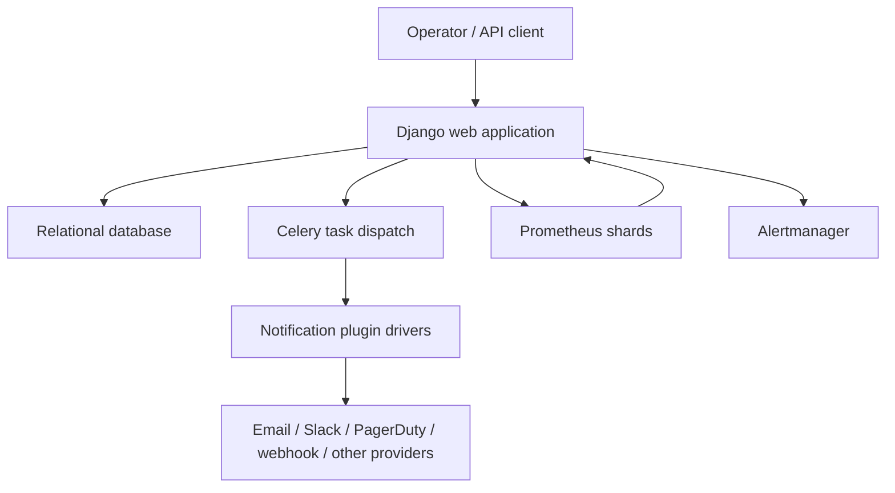
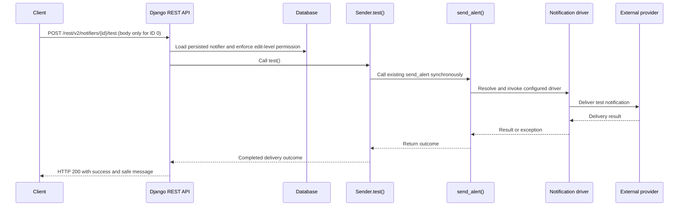

# System Architecture

## System Overview
Promgen is a single Django application. It exposes server-rendered pages, legacy REST endpoints, a version 2 REST API, configuration endpoints, and proxy endpoints. A relational database stores monitoring configuration and authorization data. Celery dispatches alert work, either eagerly or through a configured broker. Notification drivers are discovered through Python entry points.

## Architecture Diagram

Text alternative: Requests enter Django views and REST viewsets. Django reads and writes the database, schedules notification tasks, and proxies or generates monitoring configuration. Celery tasks invoke registered notification drivers and external providers.

## Component Descriptions
### `promgen` application — Application
- **Purpose**: Main web and API service.
- **Responsibilities**: Django models, views, REST APIs, serializers, permissions, configuration and monitoring integrations.
- **Dependencies**: Django, Django REST Framework, Guardian, Celery, Prometheus client, provider libraries.
- **Type**: Application.
### `promgen.notification` — Shared integration layer
- **Purpose**: Define and discover notification drivers.
- **Responsibilities**: Driver interface, provider rendering and alert delivery.
- **Dependencies**: `promgen.models`, plugin entry points, external provider APIs.
- **Type**: Shared / Client.
### `promgen.tests` — Test package
- **Purpose**: Unit and Django integration coverage with fixtures and test helpers.
- **Responsibilities**: Validate models, routes, views, APIs, and notification drivers.
- **Type**: Test.

## Data Flow

For ID 0, the API validates sender and destination, then creates an unsaved `Sender`; no notifier lookup or object permission applies. Persisted notifier IDs continue to require an edit-level object permission. Authentication and validation failures, permission failures, and missing persisted notifiers send nothing and retain standard REST behavior. Once delivery is attempted, success and failure both return HTTP 200. Failure responses include exception text with common credential assignments redacted and exclude tracebacks. Both paths reuse `Sender.test()` and `send_alert`; the HTML test endpoint remains a separate POST handler that redirects with a flash message.

## Integration Points
- **External APIs**: Prometheus and Alertmanager HTTP APIs; provider APIs used by installed notification drivers.
- **Databases**: Django-configured relational database for models and permissions.
- **Third-party Services**: Notification providers registered via `promgen.notification` entry points.
- **Infrastructure Components**: Docker and docker-compose definitions; deployment details are environment-configured. No CDK or Terraform package was found in the repository scan.
