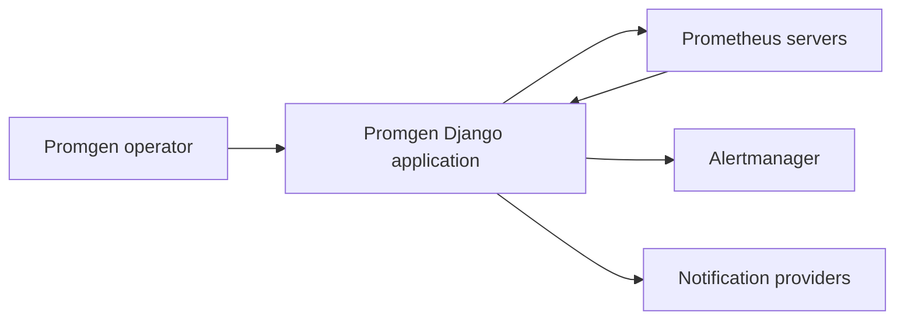

# Business Overview

## Business Context Diagram

Text alternative: Operators configure monitoring targets, rules, and notification routes in Promgen. Prometheus and Alertmanager exchange configuration and alert data with Promgen; Promgen sends notifications through configured providers.

## Business Description
- **Business Description**: Promgen generates and manages Prometheus configuration and alerting routes through a Django web application.
- **Business Transactions**: Register services and projects; manage exporters and monitoring targets; configure alert rules; receive and process alerts; manage notifier destinations and filters; test a configured notifier by synchronously sending a sample alert through the REST API; generate Prometheus and Alertmanager configuration; query monitoring systems through proxy endpoints.
- **Business Dictionary**:
  - **Service**: A monitored service grouping projects and related configuration.
  - **Project**: A Promgen-owned monitoring domain associated with a service.
  - **Notifier**: A `Sender` record that routes an alert to a notification driver and destination.
  - **Shard**: A Prometheus data source managed by Promgen.
  - **Filter**: A label name/value condition controlling whether a notifier receives an alert.

## Component Level Business Descriptions
### Promgen Django application
- **Purpose**: Manage Prometheus monitoring configuration and alert delivery.
- **Responsibilities**: Web UI, REST APIs, persistence, authorization, configuration generation, asynchronous alert dispatch, and notification integrations.
### Notification plugins
- **Purpose**: Deliver alerts to provider-specific destinations.
- **Responsibilities**: Render and transmit notifications for configured notifier records.
