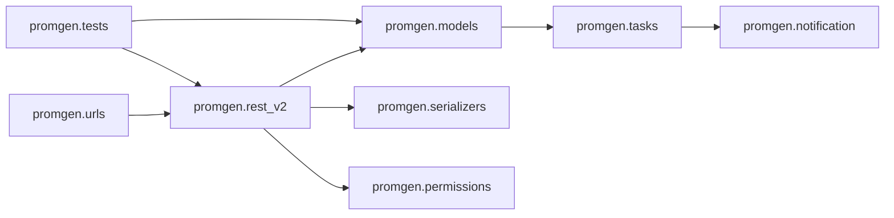

# Dependencies

## Internal Dependencies

Text alternative: URL configuration routes to REST viewsets. Viewsets use models, serializers, filters, and permission helpers. Models dispatch notifier test alerts through task code to notification drivers. Tests exercise these layers.

### `promgen.rest_v2` depends on `promgen.models`, serializers, filters, and permissions
- **Type**: Runtime.
- **Reason**: Handle API requests, shape response data, filter records, and enforce access.

### `promgen.models` depends on `promgen.tasks` and notification plugins
- **Type**: Runtime (lazy task import in `Sender.test()`).
- **Reason**: Dispatch sample and production alerts through registered notifier drivers.

## External Dependencies
- Django 4.2.26 — web framework/ORM — BSD-3-Clause.
- Django REST Framework — REST API framework — BSD-3-Clause.
- django-guardian — object-level permissions — BSD-3-Clause.
- Celery — task queue — BSD-3-Clause.
- drf-spectacular — OpenAPI schema support — BSD-3-Clause.
- Prometheus client — metrics exposition — Apache-2.0.
- Requests — HTTP integrations — Apache-2.0.
- Other dependencies are declared in `pyproject.toml`; versions are not pinned there unless stated.
